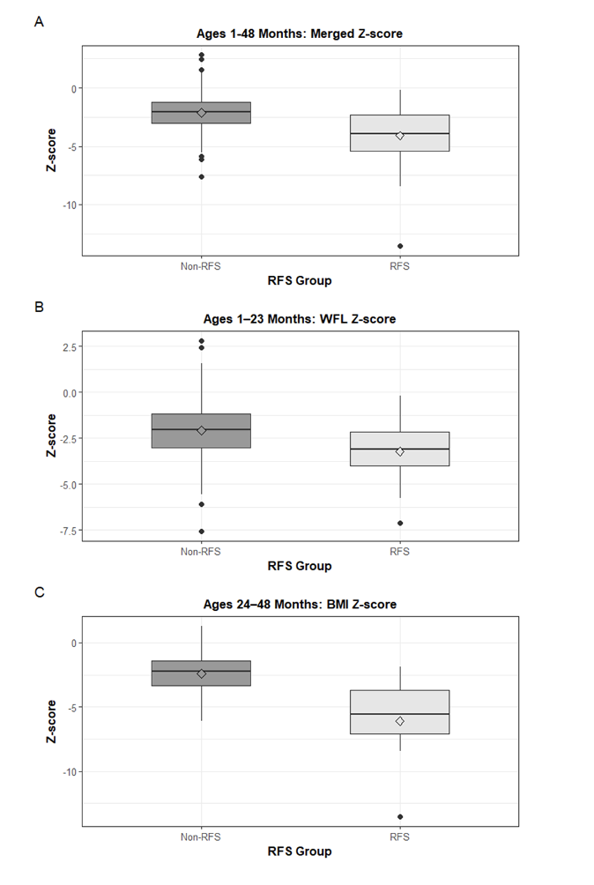

# ⚕️ Refeeding Syndrome Risk Analysis

### Phoenix Children’s Hospital \| 2019–2023

   

------------------------------------------------------------------------

## Authors

**Refeeding Syndrome: Incidence, Characteristics, & Outcomes in Malnourished Hospitalized Children**

**Authors:**\
Bethany Farretta, MD¹˒²; Timur Raghib, MD¹˒²˒³; Michael Duffy, MS RD CSP CNSC¹;\
Jacey Cardwell, MS RD CSP¹; Stephanie Conrad, DO¹˒²˒³; Katherine Dyer, DO¹˒²˒³;\
Krisha Mansukhani, MS¹; Lucia Mirea, PhD¹; Andrew Ritchey, MS¹; Edward L. Swing, PhD¹˒²˒³;\
Nehal Thakkar, MD MBA¹˒²˒³; Joseph C. Woolley, DO¹˒²˒³;\
*Maheshwor Kafle, MD¹˒²˒³; Sandra Gage, MD PhD¹˒²˒³*

*Contributed equally as co-senior authors*

**Affiliations:**\
¹ Phoenix Children’s Hospital, Phoenix, Arizona\
² University of Arizona College of Medicine – Phoenix, Phoenix, Arizona\
³ Creighton University School of Medicine, Phoenix, Arizona

Presented at the **Pediatric Academic Societies (PAS) Meeting 2025**, Honolulu, Hawaii.

------------------------------------------------------------------------

## Overview

This project investigates **refeeding syndrome (RFS)** — a potentially life-threatening electrolyte imbalance during nutritional rehabilitation in malnourished children. The study identifies demographic and clinical risk factors and quantifies incidence using **ASPEN (2020)** criteria.

> **Goal:** Determine incidence and predictors of RFS in malnourished hospitalized children ages 1–48 months.

------------------------------------------------------------------------

## Study Design

**Type:** Retrospective cohort\
**Population:** 547 hospitalized children (1–48 months) with dietitian-confirmed malnutrition\
**Timeframe:** Jan 2019 – Aug 2023\
**Inclusion:** Malnutrition diagnosis within 72h of admission; LOS \> 72h\
**Exclusion:** Confounding diagnoses (renal, cardiac, DKA, pyloric stenosis, etc.); outpatient electrolyte supplementation

**RFS definition:** ≥10% decrease in K, Mg, or Phos within 5 days of nutritional rehabilitation (ASPEN 2020).

------------------------------------------------------------------------

## Methods

| Step | Description |
|----|----|
| **Data extraction** | EHR query for demographics, WFL/BMI z-scores, feeding route, LOS, labs (K, Mg, Phos). |
| **Cleaning** | Removed incomplete z-scores/labs; validated malnutrition codes vs dietitian diagnosis. |
| **Statistics** | Wilcoxon rank-sum, Fisher’s exact, χ² tests; α = 0.05. |
| **Software** | SAS 9.4; R (tidyverse, ggplot2). |
| **Outcomes** | Incidence ± 95% CI, age, z-scores, LOS, feeding route, mortality. |

------------------------------------------------------------------------

## Key Results

-   **Incidence:** 4.2% (95% CI: 2.7–6.2%)\
-   **Age:** RFS patients were older (16 vs 5 months; *p* = 0.0005)\
-   **Nutrition status:** Lower WFL/BMI z-score (−3.91 vs −2.07; *p* = 0.0049)\
-   **Feeding route:** Tube-assisted feeding more frequent (30.4% vs 9.5%; *p* = 0.006)\
-   **Length of stay:** Longer LOS (8 vs 5 days; *p* \< 0.001)\
-   **Mortality:** None observed

------------------------------------------------------------------------

## Visuals (from manuscript)

------------------------------------------------------------------------

## Skills Demonstrated

Clinical data cleaning • Non-parametric tests • Reproducible reporting • Publication-grade figures • Manuscript-level communication

------------------------------------------------------------------------

## 🔗 Citation

**Refeeding Syndrome: Incidence, Characteristics, & Outcomes in Malnourished Hospitalized Children**\
Phoenix Children’s Hospital \| Presented at the [**Pediatric Academic Societies (PAS) Meeting 2025**](https://2025.pas-meeting.org/agenda.asp?startdate=4/25/2025&enddate=4/25/2025&BCFO=M&pfp=days&fa=&fb=&fc=&fd=), Hawaii, United States.

------------------------------------------------------------------------
